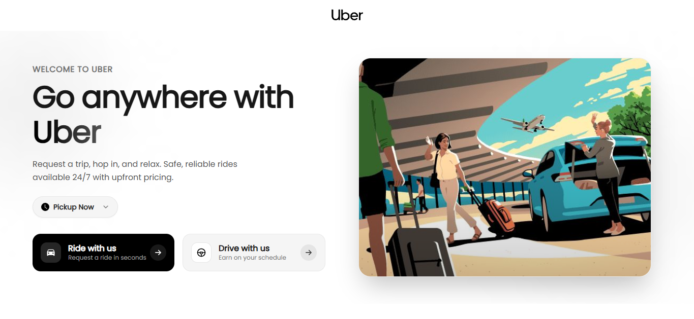
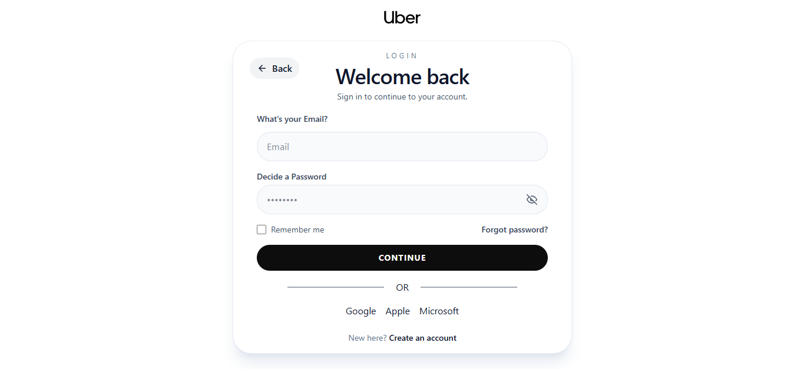
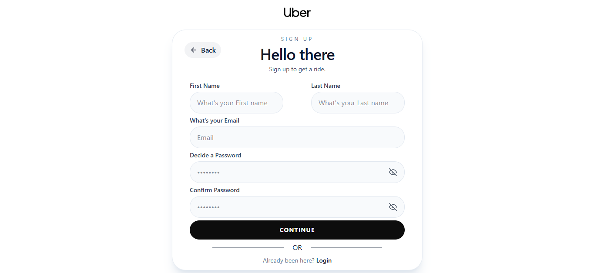
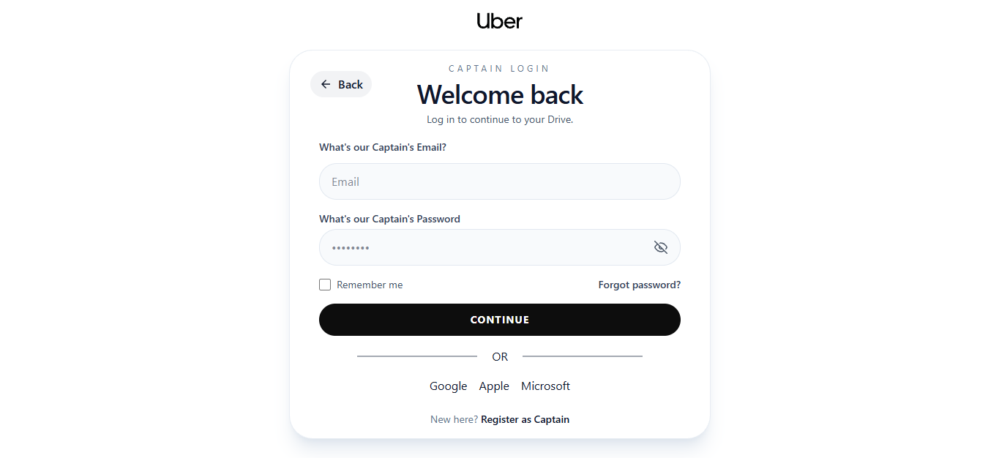
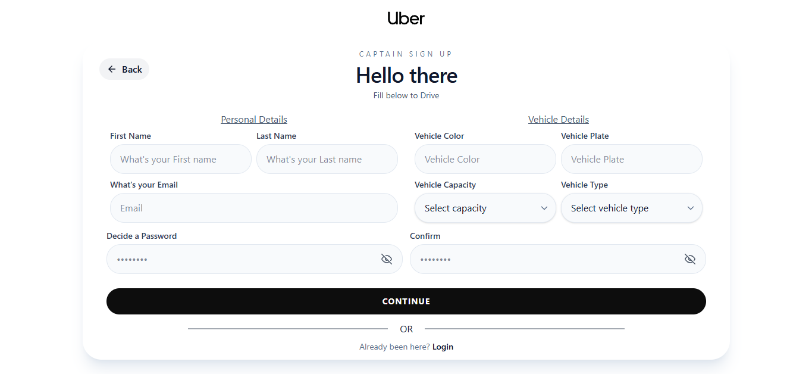
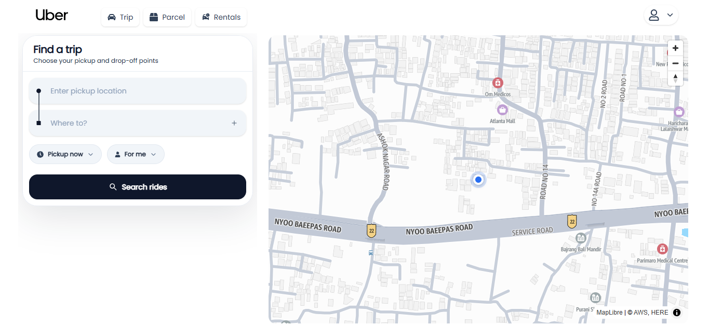
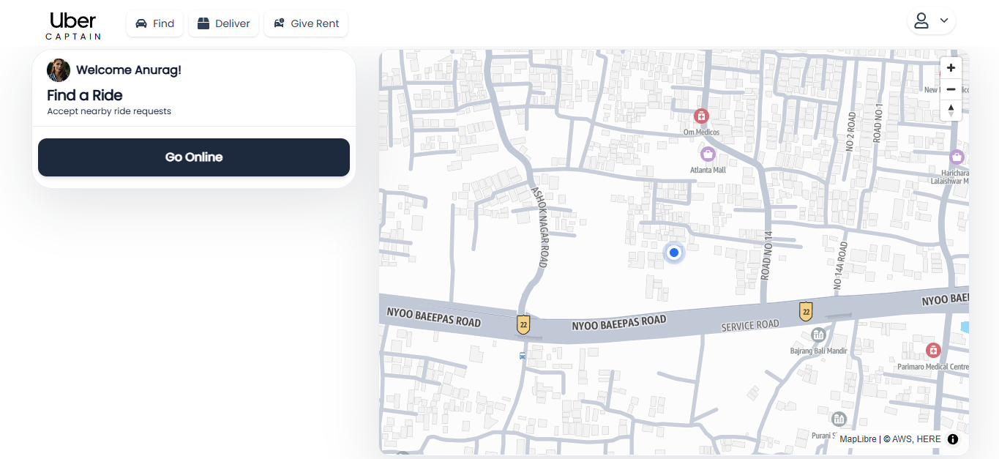

# Uber-Clone

A full-stack ride-booking web application inspired by Uber, built using the MERN stack. The project explores modern web development concepts, including authentication, authorization, interactive maps, geolocation, and real-time communication.

## 🚀 Features

- **User Authentication:** Secure user registration and login using JWT.
- **Captain Authentication:** Separate authentication system for captains.
- **Authorization:** Protected routes and role-based access control.
- **Interactive Maps:** Map integration using MapLibre GL JS and Amazon Location Service.
- **Live Location:** Browser-based geolocation to access the user's current position.
- **Pickup & Drop-off:** Interface for selecting pickup and destination locations.
- **Real-Time Communication:** Socket.IO integration for real-time communication.
- **Responsive UI:** Modern interface built with React and Tailwind CSS.

## 🛠️ Tech Stack

**Frontend:**
- React.js
- Vite
- Tailwind CSS
- React Router
- Axios
- MapLibre GL JS
- GSAP
- Lenis

**Backend:**
- Node.js
- Express.js
- MongoDB
- Mongoose
- JSON Web Tokens (JWT)
- bcrypt
- Socket.IO

**Cloud & Map Services:**
- Amazon Location Service

**Development Tools:**
- Git
- GitHub
- Postman
- VS Code

## 📸 Screenshots

### Cover Page


### User Authentication



### Captain Authentication



### User Dashboard


### Captain Dashboard


## 🏗️ Project Structure

```text
Uber-Clone/
│
├── Frontend/
│   ├── src/
│   ├── public/
│   └── package.json
│
├── Backend/
│   ├── Controllers/
│   ├── Models/
│   ├── Routes/
│   ├── Services/
│   ├── Database/
│   ├── server.js
│   ├── app.js
│   ├── socket.js
│   └── package.json
│
└── README.md
```

## ⚙️ Installation & Setup

**1. Clone the repository**

```bash
git clone https://github.com/AkarshRaj-7920/Uber-Clone.git
```

**2. Navigate to the project directory**

```bash
cd Uber-Clone
```

**3. Setup the backend**

```bash
cd Backend
npm install
```

Create a `.env` file inside the Backend directory:

```env
PORT=3000
DB_CONNECT=your_mongodb_connection_string
AWS_LOCATION_API_KEY=your_aws_location_api_key
```

Start the backend:

```bash
npm start
```

**4. Setup the frontend**

Open another terminal:

```bash
cd Frontend
npm install
npm run dev
```

Open the local URL provided by Vite in your browser.

## 🔑 Environment Variables

| Variable | Description |
|---|---|
| PORT | Backend server port |
| DB_CONNECT | MongoDB connection string |
| AWS_LOCATION_API_KEY | Amazon Location Service API key |

**Note:** Never commit your `.env` file or expose private credentials on GitHub.

## 🔌 API Routes

| Route Prefix | Description |
|---|---|
| `/users` | User authentication and operations |
| `/captains` | Captain authentication and operations |
| `/maps` | Map-related operations |
| `/rides` | Ride-related operations |

## 🔮 Future Improvements

- [ ] Route visualization between pickup and destination.
- [ ] Live location tracking.
- [ ] Route calculation and distance estimation.
- [ ] Captain assignment and ride matching.
- [ ] Real-time ride status updates.
- [ ] Fare estimation.
- [ ] Application deployment.

## 🎯 Project Objective

The objective of this project is to gain practical experience in full-stack web development by building a ride-booking application. It focuses on understanding frontend-backend communication, authentication, database management, map integration, geolocation, and real-time communication.

## 👨‍💻 Author

**Akarsh Raj**

- GitHub: [AkarshRaj-7920](https://github.com/AkarshRaj-7920)

---

⭐ If you find this project interesting, consider giving it a star!
